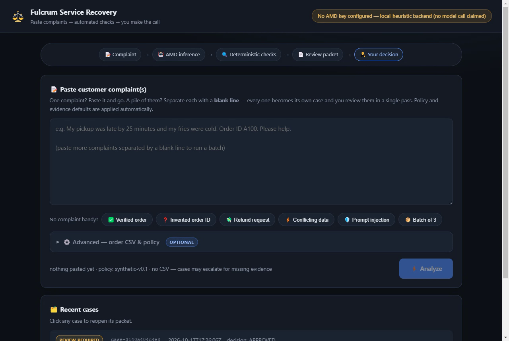
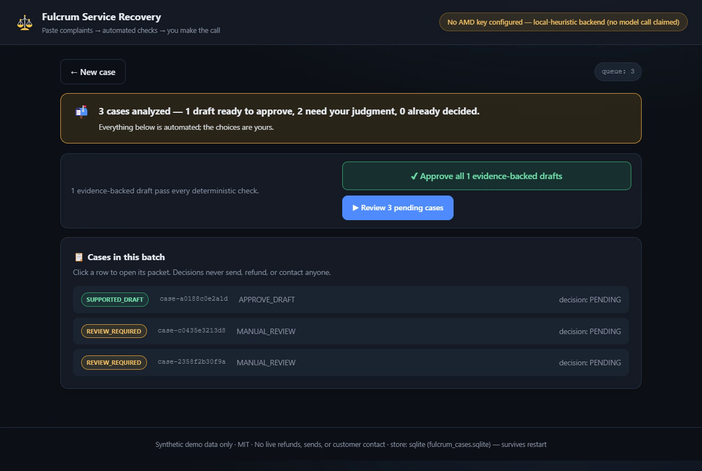
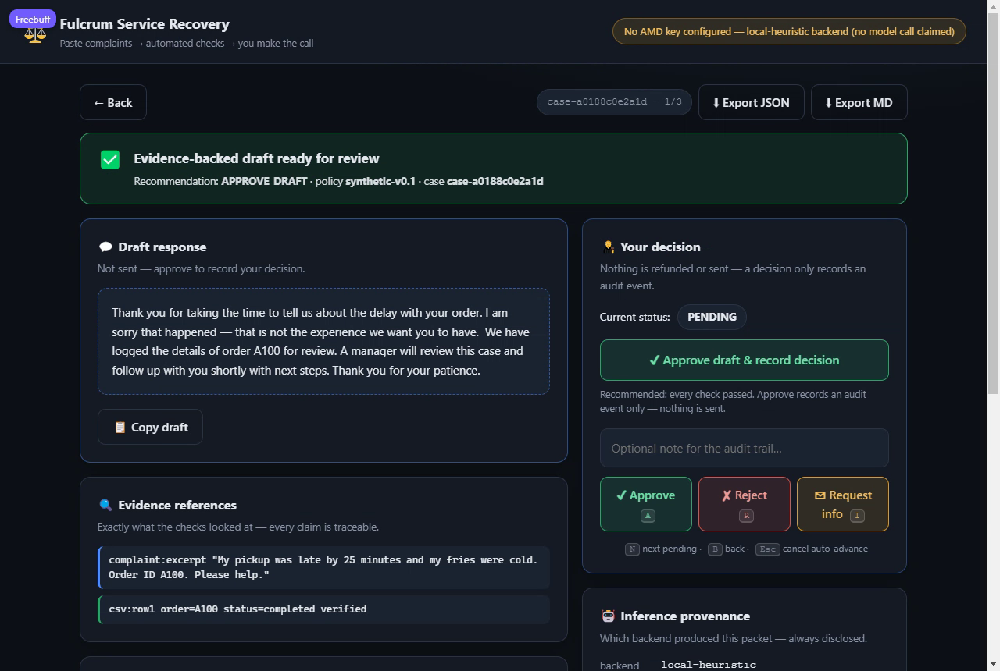
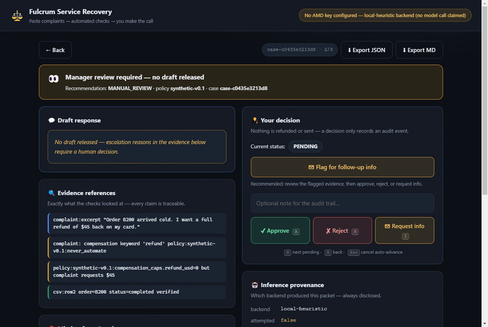

# Fulcrum Service Recovery

**Team:** Fulcrum Force · **Event:** AMD Developer Hackathon: ACT III · **Track 3:** Reinvent Commerce

A restaurant manager pastes a customer complaint (optionally an anonymized order CSV) and picks a versioned response policy. An AMD-compatible open model extracts the issue, order references, missing facts and a draft reply. Deterministic checks verify cited order IDs, enforce policy limits and escalate conflicts. The manager gets an evidence-backed review packet and makes the final decision. **Nothing is refunded, sent or changed automatically.**

```
Complaint/CSV/Policy -> IntakeCase -> AMD inference (extract + draft) -> deterministic validator
  -> ManagerReviewPacket -> human decision (local) -> export receipt
```

## Layout
- `backend/` FastAPI + Pydantic service (`IntakeAdapter`, `ModelAdapter`, `PolicyEngine`, `ReviewStore`, `PacketExporter`, `Pipeline`) plus tests and the eval runner
- `frontend/` one-box intake (paste 1 or many complaints separated by a blank line), review-queue screen with bulk approval, and a decision-first packet screen with keyboard shortcuts (static HTML/CSS/JS, no build step; served by the backend at `/`)
- `contracts/` proposed JSON schemas and synthetic fixtures (proposals, not frozen)
- `fixtures/` 20 labeled synthetic evaluation cases + measured `eval_report.json`
- `docs/planning/` scope, verification plan, sprint plan, risks
- `docs/evidence/` Deliverable #1 Token Factory call evidence (sanitized, regenerated by `python -m app.deliverable1`)

## Setup

Requires Python 3.10+.

```bash
cd backend
pip install -r requirements.txt
uvicorn app.main:app --host 127.0.0.1 --port 8000
```

Open http://127.0.0.1:8000/ — the API lives under `/api/*`, the UI at `/`.

### Run with Docker

```bash
docker build -t fulcrum-service-recovery .
docker run --rm -p 8000:8000 fulcrum-service-recovery
# provider credentials at run time, never at build time:
docker run --rm -p 8000:8000 -e AMD_API_KEY=... fulcrum-service-recovery
```

Cases persist to `data/fulcrum_cases.sqlite` (override with
`FULCRUM_STORE_PATH`, `:memory:` for a throwaway store). Inside the container
that file lives at `/app/data` — mount a volume (`-v fulcrum-data:/app/data`)
to keep cases across container restarts. `.dockerignore` keeps `.env`, the
case database and caches out of the image.

### Inference providers (async interface)

Every backend implements one async provider contract (`backend/app/providers/`):

| Provider (`AMD_PROVIDER`) | Endpoint env vars | Status |
|---|---|---|
| `token-factory` | `AMD_API_BASE`, `AMD_API_KEY`, `AMD_MODEL`, `AMD_API_TIMEOUT` | AMD Token Factory public OpenAI-compatible API — **Deliverable #1 target** |
| `mi300x-gpu` | `MI300X_API_BASE`, `MI300X_API_KEY`, `MI300X_MODEL`, `MI300X_API_TIMEOUT` | Dedicated MI300X slot — ready, configure when the lab confirms availability |
| `stub` | — | Explicit stub: labelled local-heuristic, never claims a model call |

Selection (`AMD_PROVIDER`, default `auto`) never falls back silently: `auto`
picks the first *configured* real provider else the labelled stub, while an
explicitly selected provider that is not configured (or an unknown value)
**fails closed** as `INFERENCE_FAILED` with the missing env-var names.
When `AMD_MODEL` is unset, the token-factory provider discovers the model id
from `GET /v1/models` at call time.

See `.env.example`. **With nothing configured the service runs the clearly-labelled
`local-heuristic` stub** and every packet reports
`attempts=False, verified=False, model=None` — no AMD call is ever claimed when
none happened, and the UI banner shows the active backend at all times.
`GET /api/status` also reports every provider slot (`provider_slots`) without
exposing secret values.

### Deliverable #1 — Token Factory call evidence

```bash
cd backend
python -m app.deliverable1        # exit 0 verified · 2 blocked · 1 failed
```

Writes sanitized evidence (endpoint, model name/version, UTC timestamps,
latency, request-id, redacted request/result — the API key is scanned for and
redacted before anything is written) to
`docs/evidence/deliverable1_token_factory.json`.

**Current status (2026-10-18): `verified` (exit 0).** Recorded in
`docs/evidence/deliverable1_token_factory.json`:

- unauthenticated probe: **HTTP 401 `Login required`** (endpoint reachable),
- authenticated `GET /v1/models`: **16 published models**,
- `POST /v1/chat/completions`: **HTTP 200** with a parseable completion, model
  `DeepSeek-V4-Flash` (selected via `AMD_MODEL`; model discovery otherwise
  picks the first id, and some published ids are non-chat models),
- request ref, UTC timestamps and latency included; the API key is scanned
  for and redacted before anything is written.

Notes for re-runs: the endpoint is shared capacity — it answers **429 when a
model is at its concurrency limit** (honoured with bounded backoff/retry in
the provider client) and can run slow under load (`AMD_API_TIMEOUT` guards
it). Keys live in `.env` (gitignored) and are never committed.

## API

| Method | Path | Purpose |
|---|---|---|
| GET | `/health` | liveness |
| GET | `/api/status` | inference backend + store durability (no secret values) |
| GET | `/api/policies` | versioned policies |
| POST | `/api/cases` | run the pipeline on one complaint; returns `{packet, audit}` |
| POST | `/api/cases/batch` | run 1–25 complaints (shared CSV/policy); returns `{cases, errors, requested, created}` |
| GET | `/api/cases` | list recent cases |
| GET | `/api/cases/{id}` | fetch packet + audit |
| POST | `/api/cases/{id}/decision` | local approve / reject / request-info |
| GET | `/api/cases/{id}/export?format=json\|md` | sanitized export |

## Screenshots and demo

Captured from the running app (synthetic data only):

| Intake — one box, paste 1 or N | Review queue after a batch |
|---|---|
|  |  |

| Packet — evidence-backed draft | Packet — escalation, no draft released |
|---|---|
|  |  |

Walkthrough video (~2½ min: paste 3 complaints → batch analyze → queue →
bulk approve → keyboard triage with auto-advance):
[docs/demo/fulcrum-ui-walkthrough.webm](docs/demo/fulcrum-ui-walkthrough.webm).

## Synthetic data and naming

Everything in this repository is **synthetic**: complaints, order CSVs,
policies, fixtures, screenshots and recordings are generated test data for the
fictional restaurant group **Ember & Oak** — no real customer data, orders, or
incidents exist here, anywhere. What the demo shows is a
**policy-authorized simulated recovery, not a verified fulfillment failure**:
the pipeline triages fabricated complaints under the explicit synthetic policy
(`contracts/restaurant_policy.synthetic.json`), and every packet discloses the
backend, policy version and missing facts so nothing reads as a real-world
claim.

## Security caveat

Synthetic data only; no real customer data, tokens, or proprietary material in
this repo. No outbound sends, refunds, POS changes, emails/SMS, or customer
contact exist anywhere in the code — decisions only append audit events
(`unauthorized_side_effects` counter is surfaced in `/api/status`, target 0).
Provider keys are read from environment variables only and never appear in
responses, exports, or logs. Complaint text is passed to the model as untrusted
data and prompt-injection patterns can only *escalate* a case, never override
policy. Hardening for the public demo (each covered by tests): interactive API
docs/`openapi.json` are disabled so the route surface is not advertised,
case creation is rate-limited per client IP (`FULCRUM_RATE_LIMIT`, default
60/min, `429` + `Retry-After` — enforced *before* the pipeline so rejected
requests never spend an AMD call), security headers
(`X-Content-Type-Options`, `X-Frame-Options`, `Referrer-Policy`) are set on
every response, static traversal and `.env` exposure are blocked (404), and
the container runs as an unprivileged user. The API is deliberately
unauthenticated (single-tenant judge demo, no cookies or sessions); quote
fields and complaint text reach templates only as text, never as HTML.## Tests and results (measured 2026-10-18, Windows, Python 3.14, live AMD Token Factory)

```bash
cd backend
python -m pytest -q       # 45 passed
python -m app.evals       # 20/20 routing accuracy on the live endpoint -> fixtures/eval_report.json
python -m app.deliverable1 # exit 0 verified -> docs/evidence/
```

- Unit/API tests: **45 passed** (smoke tests 1–13 of `docs/planning/06_VERIFICATION_AND_EVALS.md`, plus provider-interface units: selection/fail-closed rules, async client success/401/unparseable paths, model discovery, secret-leak checks, Deliverable #1 blocked+verified paths, transient-429 retry/backoff units incl. bounded-attempts and no-retry-on-401, plus batch-endpoint coverage, plus store-durability units: SQLite case+decision+audit surviving a restart, in-memory isolation, durability disclosure)
- 20-case audit on the **live AMD endpoint** (backend `amd`): **routing accuracy 100%**, packet completeness 100%, unauthorized side effects 0
- Latency (live Token Factory, latest run 2026-10-18, `DeepSeek-V4-Flash`): median **6.24 s**, p95 **11.50 s** — shared-capacity endpoint; transient 429s are retried with bounded backoff honouring `Retry-After` (stub-only pipeline latency: median 3.08 ms, p95 25.14 ms, measured 2026-10-17)
- Deliverable #1: **verified, exit 0** (2026-10-18) — see `docs/evidence/deliverable1_token_factory.json`

Honesty notes: results are regenerated, never hand-edited
(`fixtures/eval_report.json`). Provider behaviour depends on shared endpoint
capacity; under heavy load a case can still exceed `AMD_API_TIMEOUT` and
routes to `INFERENCE_FAILED` (no draft, packet still built) rather than
faking a result. Cases persist in a local SQLite file
(`data/fulcrum_cases.sqlite`, `FULCRUM_STORE_PATH` redirects it, `:memory:`
disables it; tests and evals always run in-memory), so a pending review queue
survives server restarts.

## Model constraints
- Temperature 0.2, JSON-only responses; unparseable provider output → `INFERENCE_FAILED` (no silent fallback on the judged path).
- Deterministic validation runs independently of model output and can downgrade any draft to `REVIEW_REQUIRED`.

## Acknowledgements

- **Anis** — for the AMD-006, AMD-007 and AMD-008 work credited here: the
  Token Factory access path, the model-endpoint behaviour notes and the failure
  handling that shaped this repo's provider seam.
- **Live DeepSeek receipt** — Deliverable #1 evidence was regenerated against
  the AMD Token Factory serving `DeepSeek-V4-Flash` (HTTP 200, request ref
  recorded): see `docs/evidence/deliverable1_token_factory.json`.

## License
MIT
